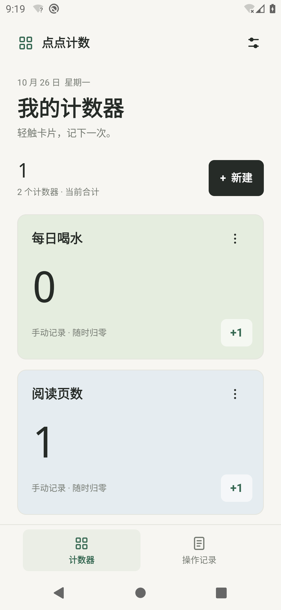

# 点点计数

中文 Android 计数器，计数和日志可离线使用，支持 GitHub 在线更新。Android 8.0 及以上可用。

[下载最新 APK](https://github.com/GodBook/diandian-counter/releases/latest) · [版本记录](https://github.com/GodBook/diandian-counter/releases) · [公开仓库](https://github.com/GodBook/diandian-counter)

本地发布包：`artifacts/diandian-counter-v1.1.0.apk`。APK 通过 GitHub Releases 分发，不纳入 Git 源码历史。



## 使用

- 点“新建”创建计数器，可命名并选择五种卡片颜色。
- 轻触卡片任意空白、名称、数字或 `+1` 区域，计数加一。点击右上角管理按钮或长按卡片，可编辑、手动归零、查看记录或删除。
- 自动重置可设为不启用、每天、每周、每月，或每隔若干分钟／小时／天。每个计数器使用独立周期。
- “操作记录”支持按计数器（包括已删除的计数器）、操作类型筛选和分页查看。右上角导出按钮将**全部**记录导出为 UTF-8 CSV，可用 Excel 或文本编辑器打开。
- 设置中可以关闭点击震动、管理“闹钟和提醒”权限、检查新版本和访问 GitHub 项目。

## 在线更新

1. 打开右上角设置，点“检查更新”。默认启动时也会检查，每天最多一次，可关闭。
2. 发现新版本后展示版本说明；点“下载更新”在应用内下载，可查看进度或取消。
3. 下载完成后，应用校验文件大小、SHA-256、包名、版本号和签名，再交给 Android 系统安装器。
4. 首次安装更新需要允许“点点计数”安装应用；从设置页返回后继续安装。覆盖安装会保留原有计数和日志。

**1.0.0 没有在线更新功能。已安装 1.0.0 的用户需要先从 Releases 手动下载 1.1.0 并覆盖安装一次，之后可在应用内更新。不要先卸载旧版。**

版本信息从 `https://github.com/GodBook/diandian-counter/releases/latest/download/update.json` 获取，正式版 APK 使用固定的版本下载地址。仅接受 HTTPS 和 GitHub 官方附件域名，自动检查失败时保持安静，手动检查会显示错误。网络无法访问 GitHub 时，计数和本地日志照常使用。

联网仅用于获取版本信息和下载 APK，不上传计数、名称或操作记录。检查结果、下载、取消、校验和安装请求也记入本地操作日志。安装后的结果由系统安装器负责确认。调试包使用调试密钥，不能覆盖更新正式发布包。

## 周期与记录

日、周、月周期按手机本地时间执行。每周从周一编号，每月 29／30／31 日遇到较短的月份时，在当月最后一天执行；下个月仍使用最初设置的日期。固定间隔从保存新周期时起算，范围为 1 分钟至 10 年。

手动归零、改名和改色不会改变已安排的自动重置时间。修改实际周期才会重新计算下一次时间。重置前的数值写入日志；关机或错过多个周期后恢复运行，会逐次补记每个周期的重置，后续空周期记为 `0 → 0`。

记录包括新建、每次加一、改名、改色、修改周期、手动／自动归零、删除、应用打开／进入后台、主页面切换、筛选、设置、管理菜单和编辑窗口的打开／取消、选择或取消导出位置、成功导出。每条记录保存时间、计数器 ID 和当时的名称、操作类型、前后数值及详情。自动重置额外保留计划执行时间。计数器与相应记录在同一个 SQLite 事务中提交，删除计数器不会删除日志，同名重建也不会合并历史。

Android 可能延后后台闹钟，尤其是未授权精确闹钟、系统省电、强行停止或关机时。设置页说明如何授权；重开应用时会补记到期重置。应用不上传计数和日志，也不会自动清理日志。卸载或清除应用数据会丢失本机数据；请定期导出 CSV。CSV 是可读的操作备份，本版本没有导入恢复功能。

## 开发与构建

原生 Java 17 + Android SDK 36 + Gradle 8.14.2 / Android Gradle Plugin 8.10.1，无第三方运行时依赖。最低 SDK 26，目标 SDK 36。无后台常驻服务。

1. 安装 JDK 17 或兼容版本、Android SDK 36、Build Tools。
2. 设置 `ANDROID_HOME`，或在不纳入 Git 的 `local.properties` 中设置 `sdk.dir`。Windows 属性文件的盘符冒号应转义，例如 `sdk.dir=D\:/dev/android-sdk`。
3. 发布密钥及 `signing.properties` 仅保存在维护者本机，不上传 GitHub。请备份 `.signing/diandian-release.jks` 与 `signing.properties`，覆盖升级必须使用同一把密钥。独立开发者可以参考 `signing.properties.example`，并用 `keytool -genkeypair` 自建密钥；自行签名的版本不能覆盖官方发布包。
4. PowerShell 7 中执行：

```powershell
.\tools\build.ps1 -JavaDirectory 'D:\dev\jdk-17'
```

脚本执行单元测试、Android Lint、发布构建，然后将签名 APK 复制到 `artifacts`。默认将中间文件放入 `%LOCALAPPDATA%\DianDianCounter\build` 下，避免 Windows 中文路径导致测试进程找不到类；可用 `-OutputDirectory` 指定其他无中文的路径。

没有发布密钥时，可运行 `bash gradlew :app:testDebugUnitTest :app:lint :app:assembleDebug` 构建调试版。仓库的 GitHub Actions 对每次主分支推送和拉取请求运行这些检查，CI 不持有发布密钥。

也可手动执行：

```powershell
.\gradlew.bat :app:testDebugUnitTest :app:lint :app:assembleRelease '-PcounterBuildDir=D:/dev/diandian-counter-build'
```

## 发布后续更新

在 `app/build.gradle` 中递增默认 `versionCode` 并修改 `versionName`，在 `docs/releases/` 新增对应版本说明，提交源码后使用同一把发布密钥运行：

```powershell
.\tools\publish-release.ps1 -JavaDirectory 'D:\dev\jdk-17' -SdkDirectory 'D:\dev\android-sdk' -OutputDirectory 'D:\dev\diandian-counter-build' -NotesPath 'docs\releases\v1.1.0.md'
```

脚本运行测试、Lint 和发布构建，从 APK 读取真实版本、最低系统版本及大小，生成 `update.json` 和 `SHA256SUMS.txt`，推送源码与对应 Git 标签，上传三个附件到草稿，最后将完整草稿设为最新正式版。禁止覆盖既有版本或移动旧标签。执行环境需要 GitHub CLI 登录，并能通过 Git 和 HTTPS 访问 GitHub；命令不内置网络代理。

每次发布必须同时附带 `diandian-counter-v版本号.apk`、`update.json`、`SHA256SUMS.txt`。版本码单调递增，正式版本名使用 `主版本.次版本.补丁版本`。无需修改应用内地址，已安装应用会从最新 Release 获取后续更新。

## 验证

`app/src/test` 包含周期边界、月末／闰年、夏令时、非法参数和 CSV 转义测试。`app/src/androidTest` 使用隔离数据库验证连续与并发计数、完整日志、错过周期补记、幂等性、分页、删除后保留历史、导出、数值溢出和持久化。

在专用测试模拟器上构建并运行设备测试（不要指向有个人数据的设备）：

```powershell
.\gradlew.bat :app:assembleDebug :app:assembleDebugAndroidTest '-PcounterBuildDir=D:/dev/diandian-counter-build'
adb -s emulator-5582 install -r D:/dev/diandian-counter-build/app/outputs/apk/debug/app-debug.apk
adb -s emulator-5582 install -r D:/dev/diandian-counter-build/app/outputs/apk/androidTest/debug/app-debug-androidTest.apk
adb -s emulator-5582 shell am instrument -w cn.diandian.counter.tests/cn.diandian.counter.CounterTestRunner
```

设备测试输出 `PASS` 才表示通过。参数 `-e mode ui` 运行实际界面流程，要求专用模拟器上的应用数据为空。后台闹钟使用 `-e mode alarm` 安排 15 秒后的归零并退出进程，再在到期后使用 `-e mode verify-alarm` 验证结果；验证模式不会主动补记，从而确认操作确实由后台接收器执行。Android 12 及以上测试精确闹钟时，先在系统设置中授予“闹钟和提醒”权限；不授权时系统可能延后执行。

在线更新设备测试使用 `-PcounterTestBuildType=release` 构建 `:app:assembleReleaseAndroidTest`，在专用模拟器安装同签名的正式版和测试包，执行 `am instrument -w -e mode updates ...`。这会访问真实 GitHub 最新版本、下载附件、校验签名和文件、测试只读安装 URI、错误元数据及检查更新状态。该套测试针对当前的 1.1.0 发布，后续版本发布时需同步升级断言。开发测试可通过 Gradle 属性 `counterVersionCode`、`counterVersionName` 构建较低版本以验证完整覆盖升级，测试包不作为正式版发布。

业务代码在 `app/src/main/java/cn/diandian/counter`：`MainActivity` 为原生界面，`CounterStore` 管理 SQLite 事务和日志，`ResetRule` 计算周期，`ResetScheduler` 与 `ResetReceiver` 安排后台归零、开机恢复和时间变更后的重新调度。`UpdateManager` 管理更新任务与状态，`UpdateHttp` 处理受限 HTTPS 请求，`UpdateFiles` 下载并校验 APK，`UpdateFileProvider` 向系统安装器临时提供只读文件。
